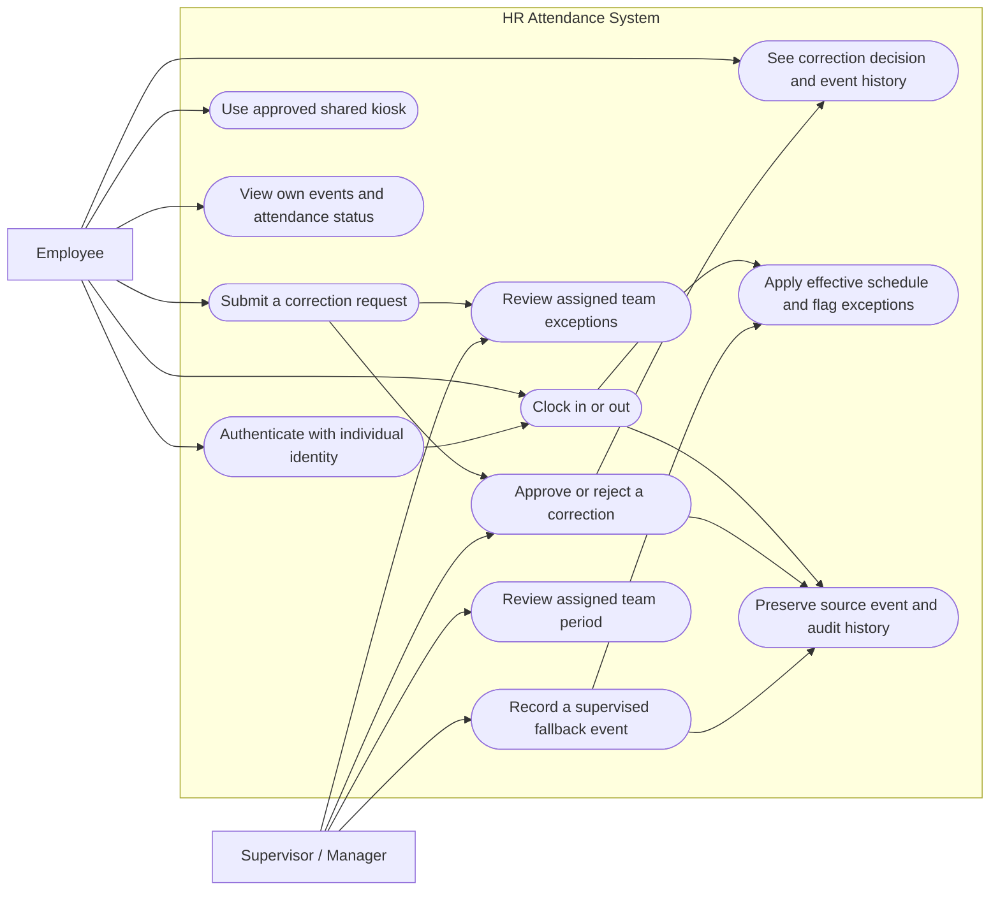
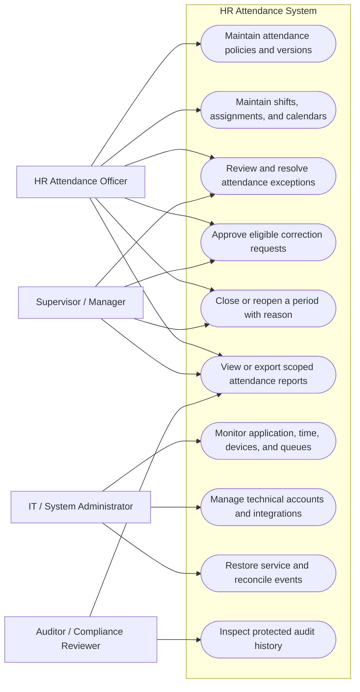

# HR Attendance System
## Scope, operating model, controls, and failure readiness

**Status:** Revised first-pass specification for stakeholder review  
**Prepared:** 30 October 2026  
**Audience:** HR, employees, managers, IT, security, and legal/privacy reviewers

> This is a requirements and operating-model document, not a legal opinion or a claim that the proposed system is already implemented. Items marked **Decision required** need an accountable owner before build or launch.

## 1. Purpose and executive summary

The system records attendance events, shows how each record was produced, routes exceptions for review, and preserves a traceable history when records are corrected. It must make failures visible, preserve evidence, and reconcile events without silently replacing the original.

The first release is an attendance recording and review system. It does **not** calculate wages, deductions, disciplinary outcomes, or payroll, and does not send attendance to payroll. Reports may show recorded time intervals and approved attendance outcomes; they must not label time as payable overtime or trigger an automatic penalty.

The initial operating context is Nairobi, with EAT (UTC+03:00) as the schedule and display zone. Store instants unambiguously in UTC and retain the applicable time-zone identifier and offset. A server's local timezone must not change the recorded instant or displayed Nairobi time.

## 2. Comparison with open-source HR/attendance projects

This review uses public code and documentation as design references, not proof that a feature is secure, compliant, or suitable unchanged for this organization.

| Reference | Useful patterns |
|---|---|
| [Frappe HRMS](https://github.com/frappe/hrms), [Employee Checkin](https://docs.frappe.io/hr/employee-checkin), [Auto Attendance](https://docs.frappe.io/hr/auto-attendance), [Shift Assignment](https://docs.frappe.io/hr/shift-assignment) | Keep raw logs distinct from calculated attendance; resolve events against effective shift assignments; represent off-shift events explicitly; account for holiday calendars and device identity mappings; do not finalize before the capture window is complete. |
| [Odoo hr_attendance](https://github.com/odoo/odoo/tree/19.0/addons/hr_attendance) and its [tests](https://github.com/odoo/odoo/tree/19.0/addons/hr_attendance/tests) | Treat kiosk and manager entry as distinct flows; test permission/sequence constraints and edge conditions. Overtime/pay calculations remain outside this first release. |
| [Horilla HR](https://github.com/horilla/horilla-hr) | Separate attendance, biometrics, geofencing, and audit concerns. Capture method, location, and audit controls are independent choices. |

### Design implications adopted

1. A punch is an **event**, not the final daily attendance result. Derived summaries must be reproducible from source events and the policy version used.
2. Shift assignment, work calendar, and holiday/rest-day data are required inputs. Missing inputs create an exception, not an inferred absence.
3. Manual, kiosk, web/mobile, and imported events need an explicit source and identity trail.
4. A signed-in clock-in records an authenticated action; it does not prove physical presence or continuous work. IP, browser, GPS, and a shared badge are not conclusive proof.
5. Tests must cover duplicates, missing/out-of-order punches, boundaries, holidays, assignment changes, retries, and permissions—not only the happy path.

## 3. Scope and boundaries

### Included in the first release

- Employees and approved worker categories; stable identifiers; team, manager, site, employment status, and effective dates.
- Work calendars, shifts, assignments, and policies required to interpret events.
- Web/mobile clock-in/out for approved accounts, plus an accessible kiosk or supervised fallback for people without company devices.
- Break events only if HR defines their policy and reporting meaning before implementation.
- Employee self-service for personal events/summaries and correction requests.
- Supervisor/HR exception queues, reasoned manual-entry/correction workflow, period review/close/reopen.
- Reports, access controls, audit history, notifications, monitoring, and outage/reconciliation procedures.
- Work-from-home attendance without continuous location tracking, screenshots, keystroke monitoring, or activity surveillance.

### Outside the first release unless re-approved

- Payroll, wage/hour settlement, deductions, compensation, leave administration, optimized rostering, and disciplinary decisions.
- Automatic penalties or adverse decisions based solely on a punch, late flag, missing event, device signal, or location signal.
- Biometrics, facial recognition, continuous GPS, geofencing, and background location capture. These need a separate business case, privacy/security review, staff notice, retention plan, accessible alternative, and approval before any pilot.
- Overnight/cross-midnight shifts until HR confirms whether they are required and boundary rules are designed and tested. “Not planned” is not evidence that nobody works one.

### Workforce/channel decisions

HR must identify whether launch covers employees only or also contractors, consultants, temporary staff, field workers, multiple entities, and remote workers. For each site/group, approve capture methods and a fallback that does not assume every person owns a smartphone or has reliable data.

For shared devices, use a dedicated kiosk flow with individual identification and a short-lived, least-privilege kiosk session. Never use a shared employee account or shared credentials. Decide whether PIN, badge, or supervised identity checking is appropriate; each has impersonation and accessibility limits. Provide a practical alternative.

## 4. Decisions required before production

| Decision | Proposal / open point | Owner and evidence |
|---|---|---|
| Workforce/legal entities | Nairobi is the starting scope; other groups/entities are undecided. | HR-approved population and site list. |
| Capture channels | Authenticated web/mobile plus accessible kiosk or supervised fallback. | HR/IT approval per site; device/support inventory. |
| Time zone | EAT (UTC+03:00) for Nairobi schedules/display; persist UTC and zone metadata. | IT confirms trusted server-time synchronization and monitoring. |
| Grace rule | 10 minutes; 08:10 is within grace for an 08:00 start; later is flagged. Never block a punch. | HR signs off on inclusive boundary and exceptions. |
| Rounding | None in release one; preserve actual instants. | Any future rule needs written, legally reviewed policy and before/after audit. |
| Shift patterns | Day shift assumption; validate overnight, split, rotating, cross-midnight needs. | HR provides representative schedules and boundary examples. |
| Holiday/rest-day inputs | Required before interpreting absence or lateness. | HR owns calendars and effective dates. |
| Correction approver | Assigned supervisor or HR; requester cannot approve own change. | HR defines escalation and alternate approver. |
| Late alert | “Third non-excused late arrival in 30 days” is a candidate, not a production default. | HR approves threshold, counted events, exclusions, recipients, deduplication, and wording. |
| Retention/privacy | Retention, access/correction, legal hold, deletion, and hosting are unspecified. | HR/legal/privacy and security approval. |
| Availability/recovery | Set RTO/RPO after hosting and offline design are known. | Business/IT approve targets and pass a realistic drill. |
| Period definition | Decide cutoffs, reviewers, close date, and unresolved-case handling. | HR and managers approve calendar. |

For a Kenya-based operation, qualified reviewers must consider the current [Employment Act](https://new.kenyalaw.org/akn/ke/act/2007/11/eng%402020-12-11/source) employment-record provisions and the [Data Protection Act, 2019](https://new.kenyalaw.org/akn/ke/act/2019/24/eng%402019-11-15/source). This document does not invent a retention period or legal basis.

## 5. Goals and success measures

Set targets with the business and measure them in a pilot:

- **No silent loss:** every event acknowledged as saved is durable; unconfirmed/offline events are visibly pending or provisional.
- **Traceability:** each event and derived result identifies source, timestamps, policy version, and correction history.
- **Fair exceptions:** no absence/lateness conclusion when schedule, holiday, or source data is incomplete.
- **Employee access:** employees can view their own events and correction status/outcome.
- **Controlled changes:** corrections, approvals, close/reopen, exports, policy edits, and privileged actions identify actor, time, reason, and before/after values as applicable.
- **Recoverability:** reconciliation counts and variances are reviewed and signed off after outage drills.
- **Accessibility:** people without a personal device, reliable connection, or ability to use the primary interface have an approved alternative.

Do not promise “100% uptime” or “zero data loss” without defining measurement, acknowledgement, offline storage, and tested recovery behavior.

## 6. Roles and separation of duties

| Role | Responsibilities | Access boundary |
|---|---|---|
| Employee | Clock permitted events; inspect own events; request corrections; see outcomes. | Own records only. |
| Supervisor/manager | Review assigned-team exceptions; provide reason/evidence; approve eligible requests; review periods. | Assigned team/effective dates. Cannot approve own request or silently overwrite a punch. |
| HR attendance officer | Own policy, calendars, exceptions, corrections, period close/reopen, and record inquiries. | Approved HR scope; high-risk actions audited. |
| Reporting officer | Review approved reports for assigned scope. | Read-only fields needed for role; exports logged/protected. |
| System administrator | Manage technical configuration, accounts, integrations, and incidents. | No routine attendance editing or business approval. |
| Auditor/compliance reviewer | Inspect records, approvals, exports, and policy history. | Read-only, scoped/time-limited, access logged. |
| Backup approver | Act during documented delegation/absence. | Delegated scope and expiry; action audited. |

Use least privilege. A person cannot request and approve the same correction. A system administrator cannot directly edit their own attendance. If an exceptional correction is unavoidable, an independent HR-authorized reviewer must approve it; preserve before/after values and reason in protected audit history. The draft’s admin self-edit capability is removed because it contradicts separation of duties. “Developer” is not an authorization role.

## 6.1 Use case diagrams

These diagrams show the system boundary and the main interactions in the first release. They use Mermaid flowcharts with oval-shaped nodes for use cases. The diagrams describe intended behavior; approval rules and access boundaries in the requirements remain authoritative.

### Figure 1. Employee and supervisor use cases

### Figure 2. HR, management, IT, and audit use cases

**Access note:** IT administration does not include routine attendance editing or approval. A requester cannot approve their own correction. HR or an independent authorized reviewer handles exceptional corrections, with before/after values preserved in the audit trail.
## 7. Event and calculation model

### Immutable source event

Store at least:

- Unique event ID and idempotency key; employee stable ID; type (IN, OUT, approved break start/end, or other expressly approved type).
- Actual event timestamp in UTC, displayed zone/offset, server receipt timestamp in UTC, and any client/device-claimed time separately as untrusted evidence.
- Capture method/source (web, mobile, kiosk, supervised, biometric/import only if later approved), device/site ID where applicable, and external source ID for imports.
- Identity/session context needed for audit without collecting unnecessary device/location data.
- Time confidence/status (online accepted, offline pending, manual, clock-drift review, rejected/duplicate) and incident/reconciliation batch ID.
- Applied shift assignment and policy version when calculated, not by changing the raw event.

Raw events are append-only. A correction is a separate linked record identifying original and proposed values, requester/operator, reason, optional evidence reference, reviewer/decision, timestamps, and policy version. A correction never erases the original.

### Derived attendance result

A versioned calculation uses source events plus effective-dated worker, shift, calendar, holiday/rest-day, and policy data. Store calculation version, source-event IDs, assumptions, unresolved inputs, and result status. If a policy changes, preserve previous results and generate a new version; never rewrite history without explaining what changed and why.

A missing shift, holiday list, incomplete pair, or unresolved clock discrepancy produces an **unknown/pending exception**, not a guessed absence or lateness. Calculate recorded duration only when relevant event pairs and rules are defined. Do not call duration “overtime,” “payable hours,” or “hours owed” in release one.

### Time and schedule boundaries

Server time is authoritative for online event acceptance. Keep client/device time separate. Offline events are not authoritative merely because the device reports a timestamp: label provisional, preserve clock source and estimated drift, and reconcile against trusted references. Preserve the original claim; any accepted event-time decision is separately approved and auditable.

Use EAT for Nairobi schedules/display; store UTC and the applicable IANA zone. Define attendance-day and shift-boundary rules, including additional zones if other locations enter scope. Under the proposal, 08:10 is within grace for an 08:00 start. Late events are still recorded. No rounding in release one.

## 8. Core workflows

### Normal attendance

1. Employee authenticates with an individual account or identifies through the approved kiosk flow.
2. System validates account status, event sequence, and availability of current effective schedule/policy.
3. System stores the raw event and returns explicit saved, pending, rejected, or duplicate status. Show success only after durable acceptance.
4. Employee can see the event and source in their own history.

### Missing or incorrect punch

1. Employee or authorized supervisor submits a correction request with event, reason, and optional supporting evidence.
2. System preserves original history and assigns an authorized reviewer.
3. Requester cannot approve their own request. Unresolved requests stay visible and do not silently become approved.
4. Approval creates an auditable correction and recalculates the summary. Notify employee of decision and provide a dispute/contact route.

### Late/missing exception

Apply lateness only when schedule, effective date, time zone, holiday/rest-day status, and event source are valid. A late flag is informational for human review. HR-approved excusal records reason and approver without altering the raw event. Missing punches alone do not prove absence or misconduct.

Repeated-lateness alerts are neutral prompts, not penalties. The “third in 30 days” proposal stays disabled until HR approves counting, exclusions, recipient, wording, deduplication, and whether employees can see/correct underlying records. Send only necessary details; avoid sensitive detail in lock-screen text.

### Period review, close, and reopen

Define period boundary, reviewers, due date, and handling of unresolved events before implementation. Close creates a versioned, read-only snapshot. Unresolved exceptions remain explicit. Reopen requires authorized reason and independent approval for high-risk changes; create a superseding version and retain old snapshots/export references.

### Manual/site/kiosk entry

Manual entry is not an invisible “admin fix.” Capture employee, original claimed time, entry time, source, operator, reason, optional evidence, and reviewer. For site outages, use uniquely numbered forms/event IDs; reconcile one by one and leave unmatched/duplicate/conflicting events in review.

## 9. Failure readiness and fallback

For each dependency define trigger, visible mode, permitted fallback, owner/alternate, maximum duration, reconciliation method, and recovery check. Thresholds below are examples, not production targets.

| Failure | Immediate behavior | Recovery/control |
|---|---|---|
| Power/site network outage | Use battery/solar only where it covers the failed component; otherwise activate tested form or local queue. Tell users whether the event reached server. | Unique IDs; record claimed time, entry time, recorder, source, reason, site. Second-person reconciliation; compare counts/conflicts. |
| Internet/WAN outage | Offline capture only on approved, tested devices; otherwise use documented form. Do not rely on a browser tab silently keeping data. | Encrypt local queue; limit retention; bind to individual/device; idempotent sync; test storage clearing, device loss, expired login, retries, and drift. Provisional until review. |
| Phone/kiosk/badge reader failure | Route to another approved individual method or supervised fallback. No shared credentials. | Record device/site and incident; reconcile; provide accessible alternative. |
| Identity provider down | Use narrowly scoped pre-approved continuity identity check and supervised capture; never disable authentication globally. | Record verifier, time, reason, later account binding; review all events. Define remote-worker path separately. |
| App/database unavailable | Publish status/owner; activate approved manual/offline method. | Tested backup/restore, approved RTO/RPO, event-count reconciliation, integrity check, HR sign-off before normal service. |
| Time source/device clock drift | Server authoritative online. Flag untrusted offline time; preserve both claim and receipt. | Define drift threshold/adjudication; never silently adjust timestamps; alert IT and route records for review. |
| Notification service failure | Keep tasks in system queues; use approved secondary channel only for urgent operational alerts. | Idempotent retry; monitor delivery; failure cannot approve/reject/delete a request. |
| Report/export failure | Keep records available; allow controlled retry. | Log requester, scope, period, time/outcome; validate counts; protect export and access. |
| HR/supervisor unavailable | Use named expiring delegation or leave work pending visibly. | No shared accounts or automatic approval; review queue on return. |
| Data corruption/tampering | Stop affected writes, preserve evidence, start incident response, use fallback. | Restore under change control; compare source queues/audit; independent reconciliation and return-to-service approval. |

### Offline mode must be proven

A full-shift offline requirement is unapproved until a pilot shows safe retention across signal loss, restart, storage pressure, expired login, and recovery. Otherwise use controlled forms. Browser-local storage is not automatically durable, encrypted, or tamper-resistant. Offline events are never presented as server-confirmed.

### Ownership and recovery targets

Name primary and alternate contacts for site fallback, HR record decisions, hosting/network, identity, each integration, and recovery approval. Set RTO/RPO with business and IT after architecture is known. RPO zero for **server-acknowledged** events is a target only if commit is durable before success and recovery is demonstrated. A locally queued, unconfirmed event is not a zero-loss event. Test after-hours and no-mobile cases.

## 10. Functional requirements

| ID | Requirement |
|---|---|
| FR-01 | Maintain worker identity, team, manager, site, work category/status, and effective dates with stable ID and auditable changes. |
| FR-02 | Support approved individual web/mobile, kiosk, and supervised capture; identify source and return explicit saved/pending/rejected status. |
| FR-03 | Persist immutable source events with UTC event time, server receipt time, zone/offset, source, identity/device context, and time confidence. |
| FR-04 | Maintain effective-dated shifts, assignments, calendars, holidays/rest days, and versioned rules; flag missing inputs rather than guessing. |
| FR-05 | Detect duplicate, missing, out-of-order, conflicting, and implausible events without deleting/overwriting source events. |
| FR-06 | Let employees inspect own records and request corrections with reason/optional evidence; show status and outcome. |
| FR-07 | Route requests using least privilege/separation of duties; requester cannot approve own request; direct admin editing is not normal workflow. |
| FR-08 | Maintain protected, tamper-evident audit history for events, changes, approvals, access, exports, policy changes, close/reopen, and reconciliation. |
| FR-09 | Support approved offline/manual fallback and idempotent reconciliation with duplicate/conflict queues and count sign-off. |
| FR-10 | Produce versioned derived results linked to source events, assignments, rules, and unresolved inputs. |
| FR-11 | Close/reopen periods under approved authority; preserve prior snapshots/exports and show unresolved exceptions. |
| FR-12 | Generate role-scoped reports with source, period, generation time, result status, and correction history; do not calculate payroll or imply payability. |
| FR-13 | Provide role-filtered dashboards, work queues, operational health, delivery state, and deduplicated notifications. |
| FR-14 | Apply late rule only against approved schedule and valid source; keep flags informational and human-reviewed. |
| FR-15 | Configure repeated-lateness alerts only after HR approval; alerts prompt review, never automatic discipline. |
| FR-16 | Define retention, legal hold, access/correction, export, and deletion under approved policy; preserve records required for audit/dispute. |
| FR-17 | Separate technical account/configuration administration from attendance decisions; log privileged access and review independently. |

## 11. Quality, security, and privacy requirements

- **Availability/resilience:** define channel-specific service targets, queue limits, RTO/RPO, backup frequency, and tested restore/fallback drills.
- **Security:** SSO/MFA where available; TLS; encryption at rest and for offline queues; secrets management; patching; vulnerability handling; incident response; session expiry; no shared accounts.
- **Access control:** enforce scope on server/API and exports, not merely by hiding UI controls. Review access after transfers/termination; disable login promptly while retaining required attendance history.
- **Audit:** record actor, event, time, reason, before/after values, approval, and source. Protect logs from ordinary administrators and independently review privileged changes.
- **Privacy:** define purpose and lawful basis; minimize fields; provide employee notice and access/correction route; approve retention, hosting/data location, processors, and cross-border handling. No continuous location, screenshots, or biometric identifiers in release one.
- **Accessibility/equity:** keyboard/screen-reader support, readable contrast, accessible kiosk placement, language needs, and a non-biometric/device-independent route.
- **Interoperability:** stable IDs, documented API/file schema, versioning, idempotency keys, error taxonomy, retry/backoff, owners, and health reporting.
- **Observability:** monitor app/database, event acknowledgement, queue age/depth, device health, time drift, identity, notification delivery, reports, and backups; route actionable alerts to named owners.
- **Performance:** define peak users/punches, ingestion latency, report response, and retry limits from pilot/workforce estimates.

## 12. Data model and reporting

Minimum concepts:

- Worker, entity, team, manager, site, employment status, and effective-dated relationship.
- Work/holiday calendar, shift pattern/assignment, attendance policy/version, and time zone.
- Immutable attendance event, event source/device, offline queue item, integration batch, incident, and reconciliation result.
- Derived result/version, exception, correction request/decision, approver/delegation, period snapshot, and export batch.
- Audit/access event, notification/outbox item, delivery attempt, retention/legal-hold record.

Keep raw event facts separate from interpretation and totals. Reports should include source events/state, unresolved inputs, approved corrections, recorded intervals, late flags/excusals, snapshot/version, and export metadata. Avoid “extra hours” and “exception hours” unless HR defines their calculation and meaning; never imply compensation treatment.

## 13. Acceptance and test scenarios

Pilot evidence must cover normal, boundary, permission, recovery, privacy, and accessibility behavior:

1. Online clock-in/out stores server event/receipt times, displays EAT correctly, identifies source, and shows records only to the employee.
2. At scheduled start + 10 minutes is within grace; one second later is late; both punches are recorded.
3. Employee without personal device uses kiosk/supervised path without shared credentials or exposure of another employee’s data.
4. Missing/overlapping shift, unassigned team, holiday/rest day, transfer, or effective-date boundary raises the right exception rather than guessing absence/lateness.
5. Missing clock-out, repeated IN, OUT-before-IN, duplicate retry, and correction in progress remain visible/auditable.
6. Employee correction request is decided by another authorized reviewer; self-approval is blocked; original event remains visible.
7. Admin cannot directly edit attendance or approve own event; exceptional path requires independent HR review and protected audit.
8. Internet outage/recovery leaves offline events clearly provisional; tested restart preserves them; sync is idempotent and flags drift/duplicates. If not, manual fallback is used.
9. Site power failure uses numbered forms reconciled individually with second-person review and count sign-off.
10. Wrong device clock preserves client claim and server receipt separately; no silent timestamp rewrite.
11. Restore test verifies acknowledged/pending event counts, audit integrity, and approved RTO/RPO.
12. Team transfer mid-period updates access/approver routing by effective date; prior approvals retain attribution.
13. Period close with unresolved events stays incomplete; reopen records authority/reason/reviewer and creates superseding snapshot/export.
14. Notification failure leaves request queued, retries without duplicates, and alerts operations.
15. Export retry creates no duplicate/altered event; scope and access are logged.
16. Employee who cannot or chooses not to use biometrics has an approved alternative; first release captures no biometric.
17. Repeated-lateness alert follows HR-approved counting, exclusions, recipient, and deduplication, and reads as a review prompt.
18. Employee access/correction request, retention expiry, legal hold, and authorized deletion are exercised with privacy/security reviewers.

## 14. Delivery plan and rollout gates

| Stage | Deliverable / exit condition |
|---|---|
| Discovery | Workforce/site inventory, policies, shift/holiday examples, channel options, privacy/legal review, data owners, incident contacts. |
| Design | Process maps, state diagrams, role matrix, event/data dictionary, retention schedule, API contracts, notification catalogue, outage playbooks. |
| Build readiness | Testable acceptance criteria; no unresolved high-risk policy assumptions; backup/restore and audit design agreed. |
| Pilot | Representative sites/device and no-device cohort, remote staff if in scope; normal flow, outages, corrections, close, export, accessibility. |
| Rollout | Training, support rota, status communications, site readiness, monitoring, controlled release/rollback, HR sign-off. |
| Operate | Monthly exception/outage review; periodic access/retention review; recovery drills; policy change control; employee feedback. |

Do not enable live attendance decisions until HR signs off schedules, grace, holidays, exception handling, approvals, notifications, and retention. Do not enable biometrics/GPS through a generic toggle.

## 15. Weak spots and flawed assumptions corrected

| First-draft issue | Risk | Fix in this revision |
|---|---|---|
| Admin could correct their own attendance with next-day review. | Conflicts with separation of duties; after-the-fact review may not prevent disputed records affecting decisions. | Removed routine admin editing. Independent HR review for exceptional corrections; requester/operator cannot approve; preserve before/after. |
| Full-shift offline could be assumed. | Browser storage, device loss, expired login, changed clocks, and tampering can lose/undermine events. | Full-shift offline is unapproved until tested; otherwise use controlled forms. Offline is provisional. |
| Device time treated as trusted. | Clocks drift or can be changed. | Server receipt is authoritative online; preserve offline claim separately and review drift. |
| Web sign-in treated as proof of WFH presence. | Authenticated action does not prove physical presence or ongoing work. | State evidence limits; no surveillance; extra evidence needs separate purpose/approval. |
| No-device question left open. | Web-only attendance excludes some employees. | Require accessible individual kiosk/supervised option and site-specific fallback. |
| “No overnight shifts” treated as settled. | Unvalidated schedules can create wrong day/absence conclusions. | Validate rosters; exclude only after confirmation; test cross-midnight if needed. |
| Late rules could ignore holidays/shift completeness. | Missing policy inputs can look like lateness/absence. | Gate late logic on valid schedule/calendar/source; missing inputs remain pending. |
| “Extra hours” despite no payroll scope. | Users may interpret attendance duration as payable overtime. | Report recorded intervals only; define any overtime meaning separately and outside release one. |
| Report fallback lacked completeness controls. | Manual summary may omit data or appear authoritative. | Validate scope/counts; log generation/access; include versions/source references. |
| Example 5/10-minute triggers looked like SLAs. | Illustrative numbers can become accidental production commitments. | Mark examples; approve thresholds and recovery targets after architecture/pilot. |
| Period close/reopen lacked unresolved handling. | Close can imply approval; revised data can mislead old reports. | Show unresolved cases; reopen creates superseding version and links prior exports. |
| Notifications underspecified. | Excessive/private alerts cause disclosure and alert fatigue. | Approve recipient, trigger, deduplication, safe wording, retries, escalation. |
| Retention/privacy was a general reminder only. | No owner, purpose, lawful basis, duration, or data-access process. | Add HR/legal/privacy approval gates; do not invent a retention period. |
| “Append-only” lacked privileged protection. | Application-level restriction may not stop admins changing logs. | Require separate protected/tamper-evident audit store and independent review. |
| RPO zero lacked acknowledgement boundary. | Pending local punch is not a durably acknowledged event. | Distinguish confirmed and pending; RPO zero only target for durable confirmed events after recovery tests. |

## Appendix A. Example outage message

> “Offline: this punch has not reached the attendance system. It is pending and not yet confirmed. Use the approved outage form or contact your supervisor. Record the time shown by your clock; do not assume the punch was saved.”

After service returns, IT checks queue health/time drift; supervisor reconciles each event; a second reviewer checks conflicts; HR reviews unresolved variances; employee sees the accepted result and source.

## Appendix B. Glossary

| Term | Meaning |
|---|---|
| Attendance event | Raw clock-in/out or other expressly approved capture event. |
| Derived attendance result | Versioned interpretation using source events and effective schedule/calendar/policy. |
| Provisional event | Offline, manual, or otherwise unresolved event pending review. |
| Server receipt time | Time server durably accepted an online event; distinct from user/device-claimed action time. |
| Reconciliation | Compare offline/manual/imported events with server records; resolve duplicate, conflict, and missing items. |
| RTO | Approved target to restore service; fallback remains active until recovery is verified. |
| RPO | Approved maximum acceptable loss of committed data; define separately for acknowledged online and pending offline events. |
| Idempotency key | Stable unique key that makes retries avoid duplicate events. |
| Period snapshot | Versioned result at close; later changes create a superseding version. |

## Sources reviewed

- [Frappe HRMS repository](https://github.com/frappe/hrms)
- [Frappe Employee Checkin](https://docs.frappe.io/hr/employee-checkin)
- [Frappe Auto Attendance](https://docs.frappe.io/hr/auto-attendance)
- [Frappe Shift Assignment](https://docs.frappe.io/hr/shift-assignment)
- [Odoo Attendance module, version 19](https://github.com/odoo/odoo/tree/19.0/addons/hr_attendance)
- [Odoo Attendance tests, version 19](https://github.com/odoo/odoo/tree/19.0/addons/hr_attendance/tests)
- [Horilla HR repository](https://github.com/horilla/horilla-hr)
- [Kenya Employment Act](https://new.kenyalaw.org/akn/ke/act/2007/11/eng%402020-12-11/source)
- [Kenya Data Protection Act, 2019](https://new.kenyalaw.org/akn/ke/act/2019/24/eng%402019-11-15/source)

